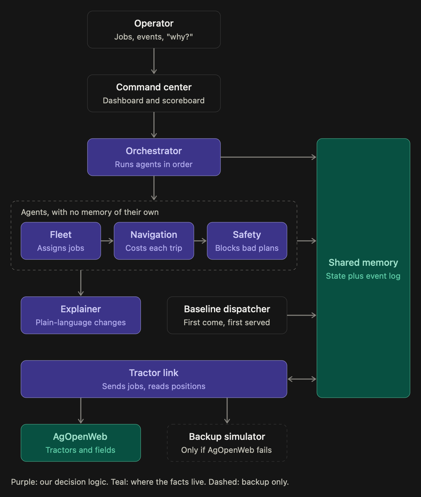

# Handoff — who builds what

For **Reya** and **Mridula**. Hand-in is **5:00 PM today**. Everything still to build is split between the two of you below; nothing is left unowned.

Read `CLAUDE.md` first (5 minutes). It has the design rules and the full description of every item. `PROMPTS.md` has a ready-made prompt for each item, numbered to match.



## Two decisions made after the first version of this handoff

1. **Every tractor now has fuel, battery and distance.** Fuel burns while driving and working. Battery drains only while working. Distance is the total km driven. The planner already handles all three: it sends a tractor to the yard to refuel or recharge when needed. These numbers must flow through to the safety checks, the comparison and the dashboard (marked **new** below).
2. **Spraying is the activity we show.** Mowing and seeding jobs stay in the plan, but the live AgOpenWeb tractor runs a spray job and the dashboard shows spraying as it happens.

## Where things stand

Already written and working (plain Python, nothing to install):

| File | What it does |
|---|---|
| `scenario.json` | The farm: 3 tractors (with fuel tank and battery size), 8 fields, 4 implements, 10 jobs, 3 events |
| `fleet/memory.py` | The one shared memory and the event log |
| `fleet/navigation.py` | Travel times between the yard and fields |
| `fleet/planner.py` | Our planner (`"smart"`) and the baseline (`"fcfs"`), including fuel, battery and distance |

Checked today on the starting plan: ours assigns all 10 jobs with 276 minutes of travel (69 km) and none late; the baseline uses 508 minutes of travel (127 km) and finishes J7 late.

To try it yourself from the repo folder:

```
python3 -c "
import json
from fleet.memory import Memory
from fleet import navigation
from fleet.planner import make_plan
m = Memory(json.load(open('scenario.json'))); navigation.rebuild(m)
tasks, unassigned, why = make_plan(m, 'smart')
print(len(tasks), 'jobs,', sum(t['travel'] for t in tasks), 'min travel')
"
```

## The split

Two tracks that can run side by side. Reya's track is a chain (each step needs the one before). Mridula's track starts independently and joins Reya's at the dashboard.

### Reya — the coordinator core (most of the judging points)

| # | Item | File | Prompt in `PROMPTS.md` | Done when |
|---|---|---|---|---|
| 1 | Safety agent | `fleet/safety.py` | 2 | Our plan returns zero violations; the baseline's late job J7 is reported. **New:** also check the battery covers each job |
| 2 | Orchestrator and events | `fleet/orchestrator.py` | 3 | All three events are handled, and a test proves the half-done job is reassigned only for its remaining minutes. **New:** keep each tractor's fuel, battery and distance up to date as tasks finish |
| 3 | Explainer | `fleet/explainer.py` | 4 | One plain sentence per plan change and a working "why?" answer, with no AI key needed |
| 4 | Demo run | `run_demo.py` | 5 | `out/event_log.jsonl`, `out/comparison.md` and `out/timeline.json` are written, and we beat the baseline with zero violations. **New:** the comparison includes distance in km; the timeline includes fuel, battery and distance per tractor and which fields are being sprayed |

Do these in order. Start with prompt 1 ("Get oriented") if you want a walkthrough of the existing code first.

### Mridula — AgOpenWeb, dashboard, README

| # | Item | File | Prompt in `PROMPTS.md` | Done when |
|---|---|---|---|---|
| 5 | Tractor link | `fleet/tractor_link.py` | 6 | One interface with two versions (`AgOpenWebLink`, and `SimLink` used only if AgOpenWeb fails), and one tractor shown live in AgOpenWeb. **New:** that tractor runs a spray job |
| 6 | Dashboard | one web page | 7 | Map of fields and tractors, job list, explanation after each event, "why?" per job, scoreboard against the baseline. **New:** fuel, battery and distance per tractor; spraying shown as it happens (tractor labelled "spraying", field shading in) |
| 7 | README | `README.md` | 8 | Says how to run it and exactly which parts used AgOpenWeb and which used our simulator |

Start item 5 straight away. It is the biggest unknown: we have not yet confirmed how an outside program gives AgOpenWeb a job or moves the tractor. Find that out first and report it before writing code. AgOpenWeb needs the .NET 10 SDK installed.

## The one place your work meets

The dashboard (Mridula) reads `out/timeline.json`, which `run_demo.py` (Reya) writes.

- **Reya:** as soon as the orchestrator runs, push a sample `out/timeline.json`, even a rough one, and tell Mridula. Do not wait for item 4 to be finished.
- **Mridula:** until that file exists, build the dashboard layout against `scenario.json` (fields, tractors, jobs are all there).
- If the file's shape has to change later, tell each other before pushing.

The explainer's sentences and "why?" answers reach the dashboard through that same file.

## Suggested checkpoints

| Time | Reya | Mridula |
|---|---|---|
| 2:00 PM | Safety agent and orchestrator working | Know how to talk to AgOpenWeb (or have decided to rely on the simulator) |
| 3:00 PM | Explainer done, sample `timeline.json` pushed | Tractor link done, dashboard layout up |
| 4:00 PM | `run_demo.py` output final | Dashboard reading the real `timeline.json` |
| 4:30 PM | Full run-through together | README done, hand-in checklist ticked |

## If time runs short

- Reya's items 1–4 are never cut. They carry most of the points.
- AgOpenWeb: keep to one live tractor. If it is still not working by 2:30 PM, switch to the simulator and say so plainly in the README.
- Dashboard: cut down to the map and the explanations.

## Hand-in checklist

| Item | Owner |
|---|---|
| Link to code: https://github.com/shrey-Bish/field-day | Done |
| Scenario file (`scenario.json`) | Done |
| Event log from the demo run (`out/event_log.jsonl`) | Reya |
| Comparison against the baseline (`out/comparison.md`) | Reya |
| README | Mridula |

## Working in the repo

```
git clone https://github.com/shrey-Bish/field-day.git
```

Accept the collaborator invite in your GitHub notifications or email first. You each work in different files, so push straight to `main`; run `git pull` before every `git push`. Commit the `out/` folder, since it is part of the hand-in.
