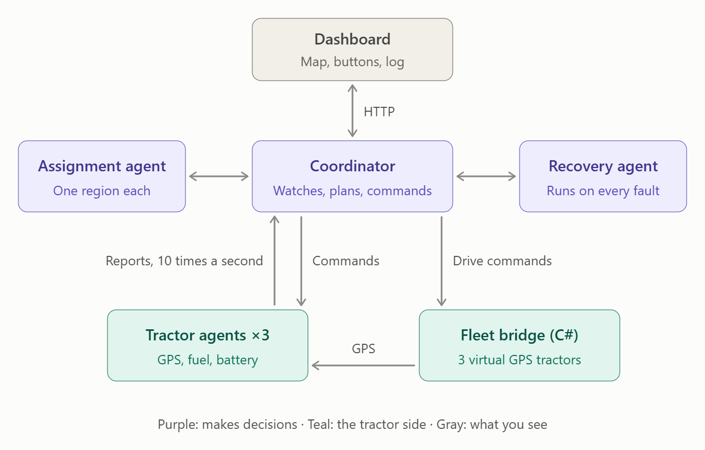
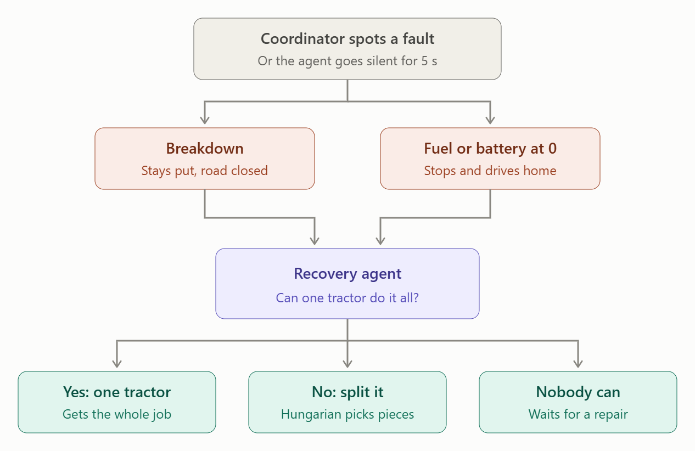

# Field Day: Run the Fleet

Hack Arizona AgX, Challenge 2 (American Tractor Company). A coordinator that gives field work to three autonomous tractors and changes the plan when something goes wrong: a tractor breaks down, a road is blocked, or a job becomes urgent.

Team: Shrey Bishnoi, Reya Attri, Mridula Buragohain.

**Slides:** [docs/Field-Day-Demo.pptx](docs/Field-Day-Demo.pptx)

## Results

Same farm, same jobs, same events and same rules for every coordinator. Numbers are measured from the tasks that actually ran, not from plans. Full table: [out/comparison.md](out/comparison.md).

| Measure | Ours (SYNTERRA) | First come, first served | Nearest compatible tractor |
|---|---|---|---|
| Jobs completed | 10 of 10 | 10 of 10 | 10 of 10 |
| Jobs finished on time | **10** | 7 | 7 |
| Travel time (min) | **356** | 544 | 484 |
| Distance driven (km) | **89** | 136 | 121 |
| Idle while on duty (min) | 0 | 0 | 0 |
| All work finished after (min) | **443** | 558 | 540 |
| Rule violations in what ran | 0 | 0 | 0 |

## What is in this repo

There are two parts. They are separate today and are described separately on purpose.

| Part | Folder | What it does |
|---|---|---|
| **The coordinator** | [`fleet/`](fleet), [`run_demo.py`](run_demo.py) | Plans 10 jobs across 3 tractors and 8 fields, re-plans on every event, checks every plan against the safety rules, explains each change, and is scored against two baselines. |
| **The live simulation** | [`fleet-sim/`](fleet-sim) | Three virtual tractors on the AgOpenWeb simulator backend, working one field side by side, with a dashboard and a recovery agent that reassigns work when a tractor fails. |

### Which parts use AgOpenWeb, and which use our own simulator

- **AgOpenWeb:** the live simulation in `fleet-sim/`. Each tractor is an AgOpenWeb `VirtualModuleHub` that sends real AgOpenGPS `$PANDA` GPS sentences over UDP, the same format tractor hardware sends. AgOpenWeb's own screen drives one tractor, so we run three of its virtual tractors behind our own dashboard. Our changes to AgOpenWeb are in [`fleet-sim/patches/agopenweb-fleet.patch`](fleet-sim/patches/agopenweb-fleet.patch).
- **Our own simulator:** the coordinator results above. `run_demo.py` steps the scenario forward in plain Python; it does not talk to AgOpenWeb.
- **Not connected yet:** the live simulation does not use job types, implements, deadlines, blocked roads or the baseline comparison. Those exist only in the coordinator run.

## Run the coordinator

Plain Python 3, nothing to install.

```
python run_demo.py            # writes out/ (demo scenario) and out/stress/ (every event type)
python evaluate.py            # writes out/optimality.md and out/adversarial.md
python -m pytest -q tests     # automated tests (needs pytest)
```

More detail on the algorithms and testing: [docs/coordinator.md](docs/coordinator.md).

## Run the live simulation

Windows, with the .NET 10 SDK and Python 3.9+. Full steps: [fleet-sim/README.md](fleet-sim/README.md).

```
cd fleet-sim
.\setup-agopenweb.ps1         # once: fetches AgOpenWeb and applies our patch
.\run-fleet-sim.ps1           # starts everything and opens http://localhost:8080
```

## How the coordinator works

Every agent is a plain function that reads and writes one shared memory. They always run in the same order.

| Agent | File | Job |
|---|---|---|
| Fleet agent | [`fleet/planner.py`](fleet/planner.py) | Decides which tractor does which job, and in what order |
| Navigation agent | [`fleet/navigation.py`](fleet/navigation.py) | Works out travel times; rebuilds them when a road is blocked |
| Safety agent | [`fleet/safety.py`](fleet/safety.py) | Checks every plan against the rules; an unsafe plan is never saved |
| Explainer | [`fleet/explainer.py`](fleet/explainer.py) | One plain sentence for every change, and an answer to "why this tractor?" |
| Orchestrator | [`fleet/orchestrator.py`](fleet/orchestrator.py) | Applies events, runs the agents in order, keeps finished work |
| Shared memory | [`fleet/memory.py`](fleet/memory.py) | The one place facts live, plus the event log |

Rules the safety agent enforces: the tractor can do the job and has the right implement, no implement is in two places, fuel and battery cover the work, the job ends before its deadline, no two tractors share a field, no trip uses a blocked road, a broken tractor gets nothing, and a half-done job is handed over only for its remaining minutes.

## How the live simulation works



When a tractor breaks down, runs out of fuel or battery, or stops reporting for 5 seconds, the recovery agent shares out its unfinished work:



Each tractor reports fuel, battery and distance driven. The demo shows spraying, and there "fuel" stands for the pesticide in the spray tank.

## Hand-in checklist

| Item | Where |
|---|---|
| Code | this repository |
| README | this file |
| Scenario file | [`scenario.json`](scenario.json) (3 tractors, 8 fields, 4 implements, 10 jobs, 3 events), plus [`scenarios/stress.json`](scenarios/stress.json) |
| Event log from the demo run | [`out/event_log.jsonl`](out/event_log.jsonl) |
| Comparison against the baseline | [`out/comparison.md`](out/comparison.md) |
