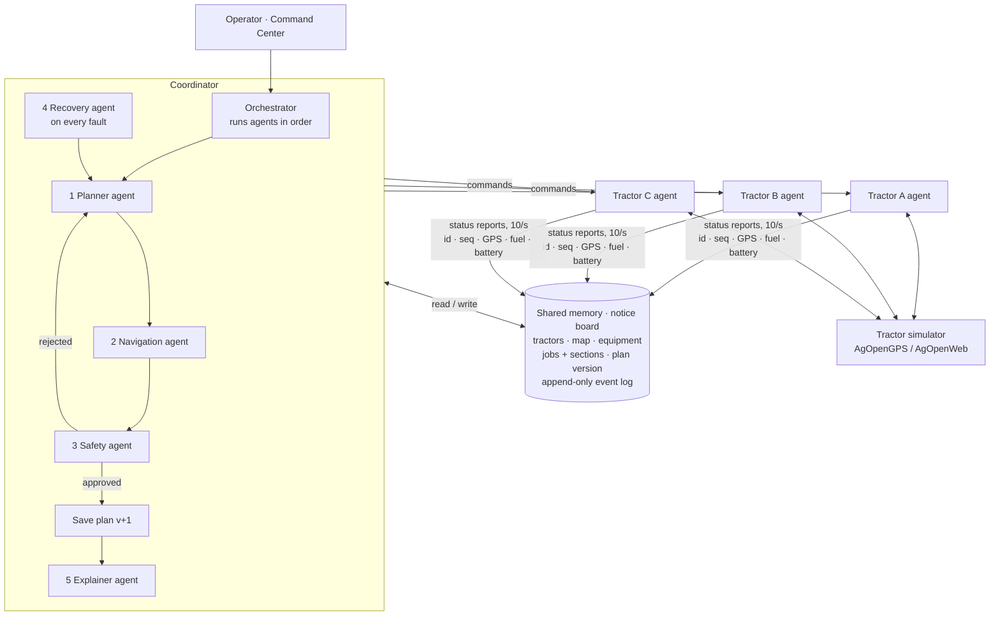

# HyperFrames prompt: SYNTERRA demo video (about 3:30)

Paste everything below the line into HyperFrames.

---

## What to make

A 3 minute 30 second explainer video for **SYNTERRA**, our entry for the Hack Arizona AgX challenge "Run the Fleet" (American Tractor Company). The audience is hackathon judges, mentors and farm operators, many of them non-technical. The video must make four things clear:
1. what SYNTERRA does,
2. **which agents make up the system, how many there are, and how they talk to each other,**
3. **what the shared memory is and why every agent uses it,**
4. how it handles failures, how well it performs, and **how LangGraph / LangChain could make it better next.**

Keep it calm, clear and confident: show what is happening on screen, say it in plain words, and use one architecture diagram that grows through the video.

- **Length:** 3:30 (210 seconds), 16:9, 1920x1080, 30 fps
- **Voice:** one warm, steady narrator, plain English, short sentences. Any technical word gets a plain explanation right after it.
- **Music:** light, optimistic acoustic or ambient, low under the voice; a small lift at the results scene.
- **On-screen text:** few words, large, sentence case, at most one line of caption at a time.
- **Look:** match our dashboard. Light frosted-glass panels, dark green accent `#12372A`, deep green `#135C36`, alert red `#C8261B`. Tractor colors: Tractor A blue `#2F6FDB`, Tractor B orange `#E07B12`, Tractor C purple `#8E4FD0`. Fonts: Space Grotesk for headings and numbers, Inter for body text. Agent boxes in the diagrams use one color per layer: decision agents dark green, tractor agents in their tractor color, shared memory as a teal "notice board".
- **Footage:** screen recordings of the live SYNTERRA dashboard (3D farm with three tractors), plus animated diagrams. Where a scene says "dashboard", show the real app.

## The story in one sentence

Self-driving tractors can each do a job, but someone has to decide who does what, and fix the plan when things go wrong. SYNTERRA is a team of software agents that plans the work, watches every tractor, and when one fails hands the unfinished work to the others, without losing or repeating a single row.

## Team (from our GitHub repo, github.com/shrey-Bish/field-day)

- **Shrey Bishnoi:** project setup: the farm scenario, the shared memory, navigation and the first fleet planner; split the work into tracks.
- **Reya Attri:** the coordinator's brain: smart planning, the safety agent, recovery that keeps finished work, the explainer, the message protocol, and all testing and benchmarks.
- **Mridula Buragohain:** the live simulation: three virtual tractors on the AgOpenGPS / AgOpenWeb simulator sending real GPS, the on-board tractor agents, the recovery agent that reassigns work on every fault, and the command center dashboard.

## The agent structure (the facts the video must get right)

**Eight agents in two layers, plus one orchestrator that runs them in order.**

Decision layer, inside the coordinator (5 agents):
1. **Planner agent:** decides which tractor does which rows and in what order. It compares many complete plans and keeps the best one.
2. **Navigation agent:** keeps the farm map (fields, roads, closed roads) and works out the shortest safe route and travel time for every trip.
3. **Safety agent:** independently re-checks every plan before it is used: right equipment, enough fuel and battery, no closed roads, no two tractors on the same rows, no job given twice. If anything fails, the plan is rejected.
4. **Recovery agent:** wakes up on every fault. It finds the failed tractor's unfinished rows and hands each one to the healthy tractor best placed to take it, considering distance, fuel and battery.
5. **Explainer agent:** turns every plan change into one plain sentence ("Tractor C broke down. 10 of 11 sections kept; J7 moved to Tractor A.").

Field layer, one per tractor (3 agents):
6–8. **Tractor agents A, B and C:** each lives "on board" its tractor. It reads its own GPS, tracks its own fuel and battery, and reports to the coordinator.

**The orchestrator** is the conductor, not a separate decision maker: when something happens it runs the decision agents in a fixed order, Planner → Navigation → Safety → save the plan → Explainer. The agents never chat freely with each other. Same input always gives the same plan.

**How they communicate:**
- **Tractor agent → coordinator: status reports, 10 times a second.** Each report is a small structured message: tractor id, a sequence number, the time, GPS position, heading, speed, fuel, battery, and a status ("ok", "low fuel", "out of fuel").
- **Coordinator → tractor: commands.** Drive commands go to the tractor ("go here", "follow this path", "stop"). Settings go to its agent ("start working", "refuel", "set fuel").
- **Every message carries an ID and a sequence number,** so a message that arrives twice is used only once and an old message can't overwrite a newer one. Safety messages (breakdown, out of fuel, lost signal) are handled first and are never dropped.
- **Health check:** no report for 2 seconds means "out of contact". After 5 seconds the tractor is told to stop, taken out of service, and the recovery agent re-shares its rows.
- **Only the coordinator assigns work.** Tractor agents report what they see; they never take another tractor's job on their own.

**The shared memory (a "notice board" every agent reads and writes):**
- **Tractors:** position, fuel, battery, distance driven, status.
- **Farm map:** fields, roads, closed or uncertain roads.
- **Equipment:** which tractor holds which implement.
- **Jobs, split into small sections** (think rows), each marked done or not done, with exactly one owner.
- **The current plan,** with a version number that goes up on every change.
- **Work in progress and history.**
- **An append-only event log:** every event with its own ID, time and plan version, never edited afterwards.

Agents keep no memory of their own; everything lives on the notice board. That's why nothing is forgotten after a failure, why finished rows can never be lost, and why every decision can be explained later.

## Architecture diagram (build it up in Scenes 3–4; reuse a small version in Scenes 9–10)

Draw the shared memory as a central notice board, with agents around it. Build one box at a time as the narrator names it. Rounded boxes, thin arrows, dashboard colors.

```
                         ┌──────────────────────────┐
                         │ Operator · Command Center │  draws the field, presses Run,
                         └─────────────┬────────────┘  reads "what just happened"
                                       │
      ┌──────────────────────── Coordinator ─────────────────────────┐
      │   Orchestrator runs, in order:                                │
      │   ① Planner → ② Navigation → ③ Safety → save → ⑤ Explainer    │
      │                    ④ Recovery agent (on every fault)          │
      └───────────────▲──────────────────────────────┬────────────────┘
                      │ reads / writes               │ commands
             ┌────────┴──────────────────┐           │ (go, follow path, stop,
             │ SHARED MEMORY · notice     │           │  start work, refuel)
             │ board                      │           │
             │ tractors · farm map ·      │           │
             │ equipment · jobs + sections│           │
             │ · plan v3 · event log      │           │
             └────────▲──────────────────┘           │
                      │ status reports, 10 per second│
                      │ (id, seq no., GPS, fuel,     │
                      │  battery, status)            │
         ┌────────────┼────────────────┬─────────────▼─┐
   ┌─────┴──────┐ ┌───┴────────┐ ┌─────┴──────┐
   │ Tractor A  │ │ Tractor B  │ │ Tractor C  │   on-board tractor agents
   │ agent      │ │ agent      │ │ agent      │
   └─────┬──────┘ └───┬────────┘ └─────┬──────┘
         └────────────┼────────────────┘
          ┌───────────▼─────────────┐
          │ Tractor simulator        │  AgOpenGPS / AgOpenWeb virtual tractors;
          │ (real GPS messages)      │  same message format as real hardware
          └──────────────────────────┘
```

Animate small dots moving along the arrows: green dots going up (status reports, many per second), dark-green dots going down (commands, only when needed), and a flash on the notice board each time something is written.

Mermaid version, if HyperFrames accepts it:



## Scenes

### Scene 1 · 0:00–0:15 · The problem
**Visual:** slow aerial drift over a big field at sunrise; three tractors waiting at the field edge. Title: "SYNTERRA". Subtitle: "One plan. Every tractor."
**Narration:** "Self-driving tractors can drive a field on their own. But someone still has to decide who does what, and fix the plan the moment something goes wrong."
**On-screen text:** "Who does what? What if one breaks?"

### Scene 2 · 0:15–0:28 · What SYNTERRA is
**Visual:** the dashboard opens; the camera glides across the 3D farm and panels.
**Narration:** "SYNTERRA is a team of software agents that plans the work for three tractors, watches each one live, and explains every decision in plain words."
**On-screen text:** "A team of agents · Plan · Watch · Explain"

### Scene 3 · 0:28–1:02 · Meet the agents (how many, what each does)
**Visual:** build the architecture diagram. First the five decision agents appear one at a time inside the coordinator box, each with a small icon (map pin for Planner, road for Navigation, shield for Safety, wrench for Recovery, speech bubble for Explainer). Then the three tractor agents appear below, one per tractor, in blue, orange and purple. A counter in the corner ticks up to "8 agents".
**Narration:** "There are eight agents in two layers. In the coordinator, five decision agents. The planner decides who does which rows. Navigation finds the safest, shortest route. The safety agent re-checks every plan and rejects anything unsafe. The recovery agent steps in whenever something fails. And the explainer puts every change into plain words. Out in the field, each tractor has its own on-board agent: three in total. An orchestrator runs the decision agents in a fixed order, so the same situation always gives the same plan. The agents never chat freely."
**On-screen text (one at a time):** "5 decision agents", "3 tractor agents", "Fixed order, no free chat"

### Scene 4 · 1:02–1:32 · How they talk, and the shared memory
**Visual:** zoom into the arrows. Show one status report as a small card flying up from Tractor B: `Tractor B · #4821 · 10:24:03 · GPS · fuel 64% · battery 88% · ok`. It lands on the notice board. Then show a command card flying down: "Tractor B: follow path". Show a duplicate card bouncing off with "already seen". Then open the notice board as a clean grid: Tractors, Farm map, Equipment, Jobs + sections, Plan v3, Event log.
**Narration:** "How do they talk? Each tractor agent sends a short, numbered status report ten times a second: where it is, its fuel, its battery. The coordinator sends commands back only when needed: go here, start work, stop. Every message has an ID and a number, so nothing is counted twice, and safety alerts always jump the queue. All of it lands on one shared memory, a notice board every agent reads and writes. It holds the tractors, the farm map, who has which equipment, every job split into small sections, the current plan with its version number, and a log of every event that can never be edited. The agents keep no memory of their own, so after any failure, nothing is forgotten."
**On-screen text (one at a time):** "Reports: 10 per second", "Every message numbered", "One shared notice board"

### Scene 5 · 1:32–1:50 · Planning and running the field
**Visual:** dashboard. Field tab: click "Use demo field" on the satellite map. Back to 3D: the field splits into three colored zones. Press Run. Tractors drive in; finished strips appear; the Progress ring climbs; Latest decisions fills.
**Narration:** "Pick a field, press Run. The planner splits the field into three zones, compares many complete plans, and keeps the best: most urgent work on time first, then the least driving."
**On-screen text:** "Many plans compared. The best one wins."

### Scene 6 · 1:50–2:30 · When things go wrong: three kinds of trouble
Three short, clearly labelled situations back to back. In each, briefly highlight on the small diagram which agent reacts (Recovery, then Safety, then Explainer).

**6a · Breakdown: stays where it stopped (1:50–2:03)**
**Visual:** press "Break down" on Tractor C. Its label turns red: "Stopped". Red alert: "Tractor C broke down · Tractor A takes over · finished rows kept".
**Narration:** "A breakdown: Tractor C stops right where it is. Its finished rows are kept. The recovery agent hands only the unfinished rows to the tractors best placed to take them."
**On-screen text:** "Breakdown: stops in place"

**6b · Out of fuel: drives home (2:03–2:16)**
**Visual:** press "Empty fuel" on Tractor A. Label turns amber: "Going home · no fuel"; it drives back to its home spot; then "At home · no fuel". Alert: "Tractor A ran out of fuel · Back home · Tractor B and Tractor C take over".
**Narration:** "Out of fuel: this tractor can still drive, so it stops work, drives itself home on its reserve, and its unfinished rows go to the others."
**On-screen text:** "Out of fuel: drives home"

**6c · Lost signal (2:16–2:30)**
**Visual:** a tractor's label shows "No signal"; a 2-then-5-second countdown; it is marked out of service and its rows re-shared.
**Narration:** "Lost signal: if a tractor goes quiet for two seconds, it's flagged. After five, it's told to stop and taken out of service, and only then are its rows handed on."
**On-screen text:** "Lost signal: flag, stop, re-share"

### Scene 7 · 2:30–2:42 · Why it can be trusted
**Visual:** close-up of Latest decisions: "Tractor A out of service, Tractor B 4 rows (+1), Tractor C 6 rows (+2). Finished work is untouched." The Safety agent box pulses green.
**Narration:** "Every change comes with a reason you can read. Finished rows are never redone, no row ever has two owners, and no plan reaches a tractor until the safety agent approves it."
**On-screen text:** "Never lose work. Never double up. Always explain."

### Scene 8 · 2:42–2:58 · The results
**Visual:** Analytics tab, "How SYNTERRA compares"; numbers count up, SYNTERRA column highlighted green.
**Narration:** "On the same farm, jobs and breakdown, SYNTERRA finished all 10 jobs on time, against 7 for a simple first-come dispatcher, and drove 35 percent less. Across 500 hard random farms it made zero safety mistakes, and on small farms it matched the perfect plan 60 times out of 60."
**On-screen numbers (one per beat):** "10 / 10 on time (vs 7)", "35% less driving", "0 safety violations in 500 farms", "60 / 60 optimal"

### Scene 9 · 2:58–3:20 · Next step: LangGraph and LangChain
**Visual:** the decision-layer diagram morphs into a LangGraph-style graph: each agent becomes a node, the arrows become edges, the notice board becomes the graph's "state" shown as a box that every node reads and updates. Highlight three additions with small badges: a loop arrow from Safety back to Planner ("retry"), a person icon between Safety and Save ("operator approves big changes"), and a speech bubble on the Explainer ("ask why?"). Label the whole scene "Proposed next step".
**Narration:** "Next, we can rebuild this agent team on LangGraph. Each agent becomes a node in a graph, and our shared memory becomes the graph's state, saved after every step, so a run can pause, replay or recover after a crash. Safety failures loop straight back to the planner, and big changes can wait for the operator's OK. LangChain would add a 'why?' chat that reads the event log and answers in plain words. The math and the safety rules would still make every decision; the language model only explains them."
**On-screen text (one at a time):** "Agents → graph nodes", "Shared memory → saved state", "LLM explains, rules decide"

### Scene 10 · 3:20–3:30 · Close and team
**Visual:** wide shot of the 3D farm with all three tractors working, then the team card over a soft field background.
**Narration:** "SYNTERRA: eight agents, one shared memory, a fix for every failure, and a reason for every decision. Built by Shrey, Reya and Mridula."
**On-screen text:** "SYNTERRA" / "Shrey Bishnoi · Reya Attri · Mridula Buragohain" / "Hack Arizona AgX · github.com/shrey-Bish/field-day"

## Facts the video may use (all measured; do not invent others)

| Claim | Value |
|---|---|
| Agents | 8: Planner, Navigation, Safety, Recovery, Explainer (decision layer) + 3 tractor agents (field layer); run in a fixed order by an orchestrator |
| Status reports | each tractor agent, 10 per second; structured message with id, sequence number, time, GPS, heading, speed, fuel, battery, status |
| Health check | 2 s without a report = out of contact; 5 s = stopped, out of service, rows re-shared |
| Message safety | every message has an ID and sequence number; duplicates and stale messages ignored; safety messages handled first |
| Shared memory | tractors, farm map, equipment, jobs split into sections with one owner each, plan with version number, work in progress, history, append-only event log |
| Jobs on time, team scenario | SYNTERRA 10/10; first-come-first-served 7; nearest tractor 7 |
| Driving time | 356 min vs 544 (first-come) and 484 (nearest), 35% less than first-come |
| All work done after | 443 min vs 558 and 540 |
| Rule violations in what actually ran | 0 for all three |
| Stress test | 500 random hard farms, 0 safety violations for SYNTERRA |
| Optimality | 60 of 60 small farms matched the exact best plan on what matters most (on-time priority work, least lateness) |
| Fleet | 3 tractors, simulated on AgOpenGPS / AgOpenWeb with the real GPS message format |

## Words to avoid on screen

"Hungarian", "beam search", "branch-and-bound", "cost function", "lexicographic", "UDP", "JSON". If the narration needs the idea, say "compares many complete plans and keeps the best", "finds the best match between tractors and rows", or "a short structured message".

## Accuracy notes (keep the video honest)

- **LangGraph and LangChain are a proposed next step, not built yet.** Label Scene 9 "Proposed next step" and use "can" or "would", never "does".
- **No language model makes decisions,** today or in the proposal. Planning, safety and recovery are math and rules; an LLM may only word explanations and answer "why?".
- The live 3D demo runs the planner, the recovery agent and the three tractor agents on the simulator. The navigation, safety and explainer agents and the benchmark numbers come from the SYNTERRA coordinator core in the same repository. Present them as one system, but don't claim the 3D view itself shows the benchmark runs.
- NVIDIA cuOpt support is built in but only runs on Linux; the demo does not use it, so do not mention it.
- The farm in the dashboard is a 3D simulation, not satellite footage. Call it "the live 3D view".
- Battery running flat behaves like a breakdown (the tractor stops where it is). Only running out of fuel sends it home.
